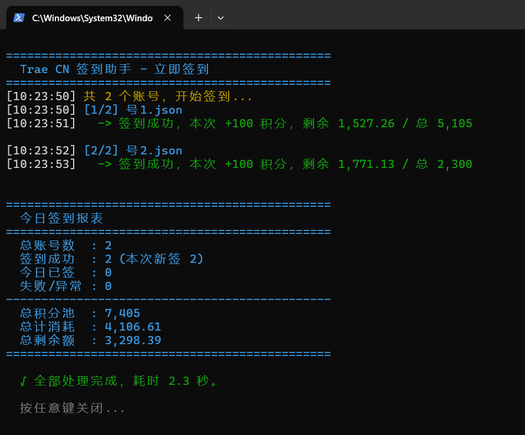

# Trae CN 多账号自动签到工具

一个轻量的 **Trae CN 每日自动签到工具**。登录一次即可离线续期，支持**多账号**与**虚拟设备隔离**。

## ✨ 功能特性

- 🚀 **单入口**：双击 `trae.cmd` 进入菜单，添加账号、立即签到、配置开机自动签到都在里面。
- 🔐 **无需客户端**：登录走官方浏览器授权，之后由脚本自动续期，不需要安装或启动 Trae。
- 👥 **多账号支持**：逐个登录，账号自动存入 `TraeAccounts`，签到自动遍历。
- 🛡️ **虚拟设备隔离**：每个账号拥有独立的设备标识，绕过“单设备单日只能签到一次”的限制。
- 🔗 **复用客户端登录态**：本机客户端已登录的账号可直接提取登录态与设备信息（菜单 4），无需再走浏览器授权。
- 📊 **统计报表**：签到结束后汇总总账号数、成功/失败数，以及总积分池、总消耗、总剩余额度。

## 📷 截图



## 🧭 为什么改用 Node.js

签到本身 PowerShell 就够用，但登录和续期涉及 ECDSA 签名、PKCE 与本地回调服务，用 Node 实现更简单可靠，因此业务逻辑统一用 Node，PowerShell 只保留计划任务配置。

## 📁 目录结构

```text
├── trae.cmd                          # 双击入口
├── src/
│   ├── trae.js                       # 菜单与签到逻辑
│   └── auth-engine.js                # 登录 / 续期引擎
├── scripts/
│   ├── task-setup.ps1                # 注册计划任务
│   └── task-remove.ps1               # 删除计划任务
├── TraeAccounts/                     # 账号数据（自动生成）
│   ├── 号1.json                      # 登录态（菜单 1 登录或菜单 4 提取）
│   ├── 号1.device.json               # 独立设备信息（勿删）
│   ├── 号2.json
│   └── 号2.device.json
├── logs/
│   └── TraeSignCenter.log            # 签到日志（自动生成）
├── readme.assets/
└── readme.md
```

## 🚀 快速开始

### 1. 安装 Node.js

安装 Node.js 18 或更高版本即可，无需安装 Trae 客户端。

### 2. 添加账号

1. 双击 `trae.cmd` 打开菜单。
2. 选择 `1. 添加账号`。
3. 输入账号备注名（直接回车使用 `号N`，已有编号时自动 +1）。
4. 浏览器会打开 Trae CN 官方授权页，完成扫码或短信登录。
5. 成功后自动生成 `TraeAccounts\号N.json` 和 `号N.device.json`，并询问是否继续添加。

每个账号只需登录一次。脚本使用独立的设备标识和密钥，登录态到期前会自动续期。

### 3. 立即签到

在菜单里选择 `2. 立即签到`。也可以直接在命令行运行：

```powershell
node .\src\trae.js --checkin
```

## 🔗 复用客户端登录态（功能 4：提取信息）

如果本机 Trae CN 客户端已经登录了某个账号，可以不再走浏览器授权，直接把这套登录态和设备信息提取到脚本里。

### 使用步骤

1. 先在客户端登录要复用的账号，并保持登录状态。
2. 双击 `trae.cmd`，选择 `4. 提取信息（账号+设备）`。
3. 输入客户端登录态路径，直接回车使用默认值 `%APPDATA%\Trae CN\User\globalStorage\storage.json`。也可以直接粘贴 `storage.json` 本身，或它的任意上级目录（如 `...\Trae CN`、`...\globalStorage`）；路径支持 `%APPDATA%` 这类环境变量和带引号的粘贴。
4. 输入保存名称（如 `号1`）。若 `号1.json` 或 `号1.device.json` 已存在，会提示是否覆盖；选 `n` 则两个文件都不改动。
5. 完成后即可正常签到，无需再在浏览器中登录。

生成的两个文件：

- `号N.json`：客户端原有登录态 + 客户端设备密钥，并写入来源标识 `traeSignCenter.source = "client"`。
- `号N.device.json`：客户端的设备 ID 与机器码。

### 限制说明

1. **不自动续期**：带 `source: "client"` 标识的账号，脚本不会自动续期（手动续期也会被拒绝），避免刷新令牌时把客户端的登录态挤掉。到期前 12 小时内会提示续签，到期后跳过签到并说明原因——按提示在客户端保持登录，重新执行一次功能 4 即可。
2. **共用同一登录态**：脚本与客户端使用的是同一份令牌。客户端续期后脚本这份会变旧，因此客户端续期后建议重新提取一次。
3. **一台设备一天只能签一个账号**：提取的是本机真实设备。若客户端当天已签到，脚本会显示「今日已签到」；把同一个提取结果用于多个账号会触发“单设备单日”限制。
4. **依赖客户端已登录**：客户端未登录或已退出登录时无法提取，会直接提示原因。
5. **路径不固定但需有效**：输入路径必须是 `storage.json` 本身或包含它的上级目录，否则会提示「未找到客户端登录态文件」。
6. **转回独立账号**：用菜单 1 重新登录同名账号会整体覆盖该文件并清除标识，之后恢复自动续期。

## ⚙️ 自动签到（开机延迟触发）

在菜单里选择 `3. 开机自动签到`，可以注册或删除计划任务，并按提示设置开机后延迟几分钟执行。只有这一步会请求管理员权限（UAC），添加账号和签到都在普通权限下运行。

也可以直接运行脚本（若提示权限不足，请用管理员身份运行）：

```powershell
.\scripts\task-setup.ps1
.\scripts\task-remove.ps1
```

计划任务在用户登录后延迟运行 `node src\trae.js --checkin --pause`，运行时会显示控制台窗口，签到结束后提示「按任意键关闭」。

> 如果计划任务是在旧目录结构下注册的，需要重新运行一次 `scripts\task-setup.ps1`（或在菜单里选择 3），把任务指向新的 `src\trae.js`。

## ⚠️ 注意事项

1. **不要删除 `.device.json`**：删除后该账号会被服务端视为新设备。重新登录同名账号时会自动沿用同名的 `.device.json`。
2. **不要在客户端频繁切号**：通过菜单 1 独立登录的账号，其登录态与客户端会话相互独立，但同一账号的会话数量有上限，客户端登录或切号有概率挤掉脚本的会话。若签到提示登录态被吊销，在菜单里重新登录该账号即可。（功能 4 提取的账号例外：它与客户端共用同一登录态，详见上文「复用客户端登录态」。）
3. **风控提示**：多设备隔离本质上是与官方风控规则进行技术对抗。如果服务端检测到异常，可能触发限流（如 `9074`）或封号。本工具仅供学习交流，**因使用本工具导致的账号风控、封禁等后果由使用者自行承担**。
4. **当天已用真实设备签到**：即使使用虚拟设备，服务端仍会提示“今日已签到”，从第二天开始才会体现隔离效果。

## 📄 开源协议

MIT License. 请勿用于非法用途。
